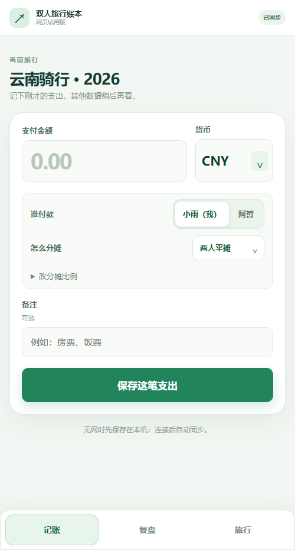

# Ride Ledger · 旅行记账与离线同行同步

一次旅行一个账本。先在各自手机上记下现金、支出和换汇；相遇时通过局域网或蓝牙交换记录，分开时继续离线记账。金额按各货币最小单位保存，现金余额与同行者之间的结算分别计算。

> **当前状态：安卓 `0.2.0-test.2` 测试版。** 双人旅行可在安卓、Windows 和网页使用；2～5 人小队旅行目前仅支持 Android 10 及以上的安卓手机。**尚无 iOS 安装包**。安卓实体双机的热点和蓝牙表现仍需验收。[下载与版本记录](https://github.com/eurTy/ride-ledger/releases) · [测试范围](tests/README.md)

## 先选旅行类型

| 类型 | 适用设备 | 同行同步 | 当前限制 |
| --- | --- | --- | --- |
| 双人旅行 | 安卓、Windows、网页 | 安卓双机可用热点或经典蓝牙；Windows 与安卓可用局域网或 HTTPS 中转；网页走 HTTPS 中转 | 浏览器不参与热点 TCP 直连 |
| 小队旅行 | 安卓 10 及以上，2～5 人 | 安卓手机之间用 Wi-Fi／热点 TCP 或蓝牙 LE L2CAP；已登记设备可在相遇时转发缺失记录 | 每人登记一台手机；首次登记须与建队手机连通；尚不支持 Windows、网页、iOS 或云中转 |

这两种旅行使用不同的邀请码和同步协议。已有双人旅行不会自动变成小队旅行；不能把小队邀请码贴进旧版客户端。小队功能仍属测试版，先用虚构账目验证自己的手机组合。

## 日常记账

1. 一人新建旅行，填写参与者姓名；其他人凭同一邀请码加入，选择自己在这趟旅行中的名字。分别新建同名旅行不会合并。
2. 新建或加入后直接进入**快速记账**。填写金额、三位货币代码、付款人和分摊方式，按“保存这笔支出”。再次打开仍进入上次的旅行。
3. 底部“复盘”查看各币种总支出、各人现金余额、结算和完整流水；“旅行”用于切换旅行、分享邀请码与连接设置。总额不占用快速记账主页。

双人旅行可选两人平摊、仅付款人承担，或展开自定义比例。小队旅行可选全员平摊、仅付款人承担；平摊的最小货币单位按固定成员顺序分配，避免各设备计算不同。原始资金代表每人带的现金，不产生彼此欠款；途中补充现金、成员还款与换汇分别记账。不同货币不自动套用汇率，结算按币种显示。

货币可直接输入三位字母代码，初始为 `CNY`。曾用代码最多保留五个，支持从下拉选择或移除；输入 `RMB` 按 `CNY` 记录。换汇表单会记住本旅行最近一笔有效换汇的两种货币。曾用货币快捷选项只保存在当前设备。

“旅行记录”保留全部流水，并可筛选共同支出、原始资金和换汇。每笔记录使用录入设备的系统时间；同步后保留原时间戳。删除单笔记录会同步删除标记。整趟旅行的删除需要先进入删除模式、点对应旅行的 ×，再二次确认；**整趟删除仅作用于本机**，重新加入同一旅行可能从其他副本恢复记录。

## 离线与同步

- **两台安卓，双人旅行：**一台开启系统热点、另一台连接；两端打开旅行后，通过 NSD 或备用 UDP 发现并用 TCP 交换加密记录。也可在两端“蓝牙连接”中开启经典蓝牙备用通道。热点优先，失败时尝试蓝牙；可手填 `IP:端口` 直连。
- **安卓小队：**队长先建立 2～5 人名单。每位成员凭码选择自己的名字，首次登记需靠近建队手机；登记后任意已登记手机相遇都可交换并转发账目。应用按可用链路在 Wi-Fi、蓝牙 LE L2CAP 和热点间切换。小队目前不经 HTTPS 云服务同步。
- **Windows 与安卓，双人旅行：**同一局域网可直接连接；不同 Wi-Fi 时，Windows 客户端可提供临时 HTTPS 中转入口并写入邀请码。电脑必须保持运行和联网；长期跨网使用可自行部署固定 HTTPS 中转。
- **网页试用，双人旅行：**浏览器本地保存，恢复网络后通过同一 HTTPS 中转同步。网页使用 `localStorage`，清除站点数据会丢失尚未同步的记录；网页不提供安卓原生的热点或蓝牙直连。

邀请码包含旅行密钥，只发给同行者。双人模式的各端用同一密钥加密流水；小队模式还把一个名字登记到一台设备，并在连接时相互认证。每笔记录有唯一 ID，重复到达不会重复入账；中断后按已有记录补传。**两人各自手动录入同一笔现实付款仍会产生两笔不同记录。**

同步需要可达的局域网、蓝牙或 HTTPS 中转；没有任何连接时先保存在本机，之后再补齐。当前同步主要在应用打开时运行，锁屏或后台不保证即时完成。

## 下载与开发

- GitHub 的 0.2 下载包按当前测试安排提供**完全未签名 APK**，只供检查，不能直接安装到手机。需要在手机上试用时，可在本机运行 `./build-debug.ps1` 生成 **debug 签名 APK**；升级安装需沿用同一个调试签名密钥。签名私钥和真实账本不上传仓库。
- 安卓原生界面使用 Java 与 SQLite，最低 Android 8.0（API 26）；小队模式要求 Android 10（API 29）及以上。使用现有 Android Studio 工程，或运行 `./build-debug.ps1` 生成 `build/dist/ride-ledger-debug.apk`；运行 `./build-debug.ps1 -SkipSigning` 生成检查用未签名包。
- Windows 客户端当前版本为 `0.1.5`，使用 Electron 和本地账本／同步服务。`npm install` 后运行 `npm run desktop`；`npm run desktop:package` 生成独立 EXE。
- 网页本地试用：运行 `node sync-server/server.mjs`，在这台电脑打开 `http://127.0.0.1:8787`。手机不能直接访问电脑的 `127.0.0.1`；跨设备网页试用需要可达的 HTTPS 地址。
- 运行网页、桌面与服务端回归：`npm test`。安卓独立测试包及实机步骤见 [测试说明](tests/README.md) 和 [安卓直连说明](docs/android-peer-sync.md)。

## 当前边界与后续

安卓 0.2 已在模拟器中检查本机 SQLite、加密、分批补传、首次登记、五台逻辑设备收敛和蓝牙传输；**实体安卓设备上的热点发现、蓝牙连接及不同厂商后台行为尚未验证**。网页和 Windows 仍是双人账本。iPhone 独立 App 尚未开发；目标是打包现有界面、使用可靠本地存储，并实现与安卓兼容的局域网协议，详见 [iOS 实施路线](docs/ios-roadmap.md)。

版本变化见 [CHANGELOG.md](CHANGELOG.md)。仓库中的示例和截图使用虚构数据，不包含用户实际旅行流水。
